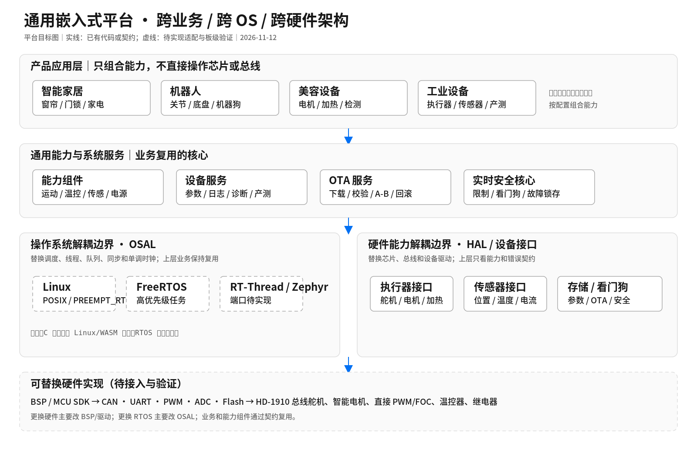

# 通用嵌入式运行时原型 · embodied-runtime

本项目面向可复用的嵌入式能力组件，目标覆盖 Linux 与 MCU/RTOS，而非仅服务于具身智能。**当前是可运行的软件仿真原型，不是量产框架。** 双轴舵机模型、C11 控制核心、浏览器 WebAssembly 与场景回放已经运行；真实硬件和 RTOS 集成尚未完成。

## 从这里开始

- [最小 OSAL：Linux 与 RTOS 如何复用周期逻辑](docs/osal.md)
- [Renode MCU 固件仿真入口](renode/README.md)
- [第一目标平台冻结：STM32G474RE + FreeRTOS/Zephyr](docs/platform-decision.md)

- [技术交流简图：六个框讲清平台](docs/architecture-simple.md)
- [代码导读：从让舵机转一下开始](docs/guide.md)
- [实现状态与限制](docs/status.md)
- [量产架构基线与发布门禁](docs/production-baseline.md)
- [当前架构图](docs/architecture.svg) · [PNG 预览](docs/architecture.png)
- [仿真实现运行图](docs/architecture-implementation.svg) · [平台目标图副本](docs/architecture-platform.svg)


- [仿真与网页的数据流](docs/simulation.md)
- [需求与阶段验收](docs/requirements.md)
- [接口契约](docs/interfaces.md) · [场景测试](docs/scenarios.md)
- [OTA 设计目标](docs/ota.md) · [量产验证清单](docs/production.md)

## 当前实现边界

| 能力 | 实际状态 |
|---|---|
| C11 控制核心 | 固定双轴、位置比例控制、命令校验、超时与传感器故障锁存；不是 FOC |
| 桌面仿真 | `er_sim_runner` 运行 normal / stale / sensor / stall 四个确定性场景，输出 JSONL |
| 浏览器 | 同一份 C 核心和仿真模型经 WASM 运行；失败时明确标识 JavaScript 演示后备模式 |
| 3D 展示 | Canvas 投影的程序化 HD1910M 示意外形，读取仿真反馈；不是物理仿真或制造级 CAD |
| STEP / STL | 官方型号 STEP 与转换 STL 已归档，作为机械参考；当前主视图并非直接使用该网格 |
| 测试 | Linux 配置含 12 项测试（有 Node 时）；没有 Node 时注册 11 项原生测试 |
| HAL / RTOS | 执行器 HAL 绑定与两类仿真驱动已接入原生/WASM；其他 HAL 为草案，`ports/` 尚无可运行 RTOS/BSP 端口 |
| OTA | 独立内存状态机原型；没有 Flash 写入、真实签名验证、掉电持久化或启动回滚 |
| 参数、日志、产测 | 需求与方案阶段，尚未形成设备服务实现 |

## Linux 构建与测试

在仓库根目录执行；用子目录运行 CTest，兼容 Ubuntu 20.04 自带的旧版 CTest：

```sh
cmake -S . -B build -DCMAKE_BUILD_TYPE=Release
cmake --build build
(cd build && ctest --output-on-failure)
./build/er_sim_runner normal
./build/er_sim_runner sensor > /tmp/servo-sensor.jsonl
python3 tools/replay.py ./build/er_sim_runner /tmp/servo-sensor.jsonl
```

`er_demo` 仍保留为单次核心调用示例。原生场景回放会重跑固定场景再逐条比较，不是任意命令流的硬件回放。

## Windows 浏览器访问 VMware 中的页面

```sh
./web/start-server.sh
```

在 Windows 浏览器打开脚本打印的 Ubuntu 地址。页面显示 **C11 核心 · WebAssembly** 时，正在运行 C 后端。调整目标、注入故障或导入日志后，3D 摇臂和曲线读取同一份状态。

源码和 WASM 构建入口见 [web/wasm](web/wasm/README.md)，浏览器事件与日志格式见 [web/protocol.md](web/protocol.md)。网页测试使用实际 WASM 和模拟 DOM，不能替代浏览器画面检查或 MCU 实时时序验证。

## 代码组织

- `src/runtime.c`：单所有者控制核心，无内部线程同步；命令提交与 step 必须由同一执行上下文串行调用。
- `sim/`：虚拟时间、双轴执行器与场景运行器。
- `web/wasm/bridge.c`：浏览器与 C 核心/仿真之间的桥接。
- `web/app.js`、`web/servo3d.js`：交互、曲线和外观展示。
- `include/er/hal.h`：设备、时钟、存储与看门狗接口。
- `src/devices.c`：闭环执行器绑定、能力检查、反馈汇总和输出分发。
- `sim/actuator.c`：有反馈与无反馈的静态仿真驱动实例。
- `src/ota.c`：未接入控制闭环的 OTA 原型。
- `tests/`：原生核心与网页 WASM 回归测试。

更新日期：2026-11-12。功能变更应同步更新实现状态、导读与测试条件；设计目标不能标为已实现。

## 带 RTOS 的业务如何在 Linux 测试

通过统一接口编写的业务可连接 Linux 或 RTOS 适配实现；直接调用 FreeRTOS API、ISR 或芯片寄存器的代码不能原样运行在普通 Linux。当前实际运行的是无 OS 依赖的 C 核心与仿真驱动，完整 OSAL/RTOS 端口尚未实现。RTOS 模拟端口也不能证明板端实时性。

最小 OSAL 已实现单调时钟、绝对截止等待与周期调度，提供 Linux POSIX 端口；任务/队列/锁及 RTOS 端口尚未实现。见 [OSAL 说明](docs/osal.md)。
