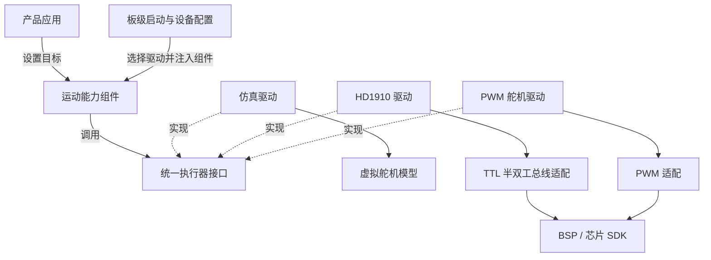
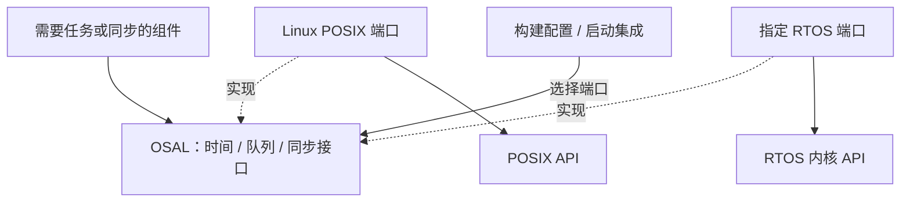

# 技术交流版：六个框讲清平台

用于白板、手绘和快速交流。这里画的是量产目标架构；当前已验证 Linux 原生与 WASM 仿真，MCU/RTOS 尚未接入。

## 平台怎么解耦

```text
          ┌─────────────────────────────┐
          │ 产品应用                     │
          │ 家居 / 机器人 / 美容设备      │
          └──────────────┬──────────────┘
                         │ 组合能力
          ┌──────────────▼──────────────┐
          │ 可复用能力与服务              │
          │ 运动 / 传感 / 参数 / OTA / 日志│
          └───────┬─────────────┬───────┘
                  │             │
          ┌───────▼──────┐ ┌────▼──────────┐
          │ OSAL         │ │ 设备接口       │
          │ 时间/任务/队列│ │ 舵机/传感/存储 │
          └───────┬──────┘ └────┬──────────┘
                  │             │
          ┌───────▼──────┐ ┌────▼──────────┐
          │ Linux / RTOS │ │ 驱动 + BSP     │
          │ 可替换        │ │ 芯片/总线/引脚 │
          └──────────────┘ └───────────────┘
```

箭头表示依赖接口，不是所有调用都必须经过所有模块。OSAL 与设备接口是两条独立适配边界；图中能力与服务放在一起只为便于交流，不代表 OTA、日志可以阻塞实时控制任务。

## 实际部署在哪里

```text
Linux 主控                    MCU 控制器
应用 / 联网 / 升级协调  ←→  实时控制 / 采样 / 保护
                      通信协议
                              ↓
                          舵机 / 传感器

硬件保护 ─────────────────→ 安全输出
```

通信需版本、序列、会话和超时约束。硬件保护与安全输出由具体设备设计；不能假设 HD1910 支持 STO，也不能把断电视为所有机构的安全状态。

## 四句话讲解

- **换产品**：换应用、组合能力，复用基础服务。
- **换系统**：适配 OSAL，复用无平台依赖的逻辑。
- **换硬件**：适配驱动和 BSP，上层通过设备接口使用能力。
- **部署隔离**：Linux 处理复杂服务，MCU 负责实时执行；通信失联后按产品定义进入安全状态。

替换后仍需验证能力契约、资源和时序，不承诺所有设备无修改互换。

详细约束见 [量产架构基线](production-baseline.md)，完整图见 [平台架构图](architecture.png)，当前进度见 [实现状态](status.md)。

## 怎么在代码里实现硬件解耦

关键是三个环节：**定义接口 → 驱动实现接口 → 启动代码绑定实现**。应用和能力组件只依赖公共接口，不包含具体驱动、芯片 SDK 或 RTOS 头文件。



实线表示调用、依赖或绑定；虚线表示“实现接口”，不是数据流。设备接口包括设定目标、读取反馈和使能操作；不支持的能力必须明确报告。

`include/er/hal.h` 已定义函数指针和 `ctx`：函数指针指向驱动实现，`ctx` 保存设备实例的私有上下文，例如总线句柄、设备地址和状态。同一驱动可以实例化多个设备，组件不解读 `ctx` 内部结构。

下面是**设计伪代码**，不是当前可直接编译的 API：

```c
/* 板级启动：此处允许知道具体型号和接线 */
actuator = hd1910_create(ttl_bus, servo_id);
motion_init(&motion, actuator);

/* 产品应用：不需要知道总线、设备地址或芯片型号 */
motion_move_to(&motion, target_angle);
```

换成仿真时，启动代码替换为：

```c
actuator = sim_servo_create();
motion_init(&motion, actuator);
```

`create` 只是示意实例初始化，并不要求动态分配；MCU 实现可使用静态实例和固定缓冲区。启动阶段必须检查能力、资源和限制配置，通过后才能允许执行；实时路径不负责创建对象或选择驱动。

## 怎么解耦操作系统



OSAL 与设备接口独立：前者解决执行环境差异，后者解决设备能力差异。纯算法只接收输入和时间，不需要为了跨平台引入线程或锁。裸机可以使用静态调度和轮询，但不保证支持所有依赖线程的组件。

## 接口相同，还必须行为兼容

| 契约 | 必须明确的内容 |
|---|---|
| 能力 | 有无位置反馈、速度或扭矩支持；无反馈设备不能伪造实测值 |
| 单位 | 弧度、rad/s 等标准单位；驱动转换编码器计数和协议单位 |
| 时间 | 单调时间、采样时间、有效期；跨设备时钟要映射，不能直接相减 |
| 错误 | 不支持、忙、超时、断线等可区分；禁止用零值冒充成功 |
| 并发 | 所有者、缓冲区寿命、是否阻塞、是否允许 ISR 调用 |
| 安全动作 | 保持、制动、断能的实际含义由产品和设备能力决定 |

例如应用要求位置反馈，普通无反馈 PWM 舵机就不满足初始化条件。驱动替换后必须运行接口一致性测试，并在目标板验证时序和安全动作；同名函数不等于行为兼容。

## 当前代码与上述设计的对应关系

- 已有：`include/er/hal.h` 的设备接口草案；Linux 原生和 WASM 共享 C 控制与仿真源码。
- 当前仿真：`runtime` 与 `sim` 直接连接，尚未通过 HAL 完成可替换设备绑定。
- 待实现：组件初始化绑定、真实 HD1910/PWM 驱动、总线/BSP 适配、完整 OSAL 及端口验收。
- 未声称完成：真实硬件互换、跨 RTOS 验证，以及软件到硬件安全输出的闭环。

阅读顺序：先用六框图解释职责，再用接口实现图解释替换点，最后用状态表说明验证证据。
